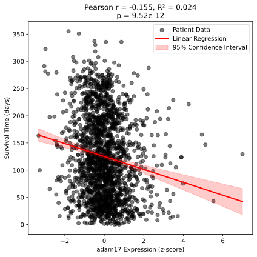
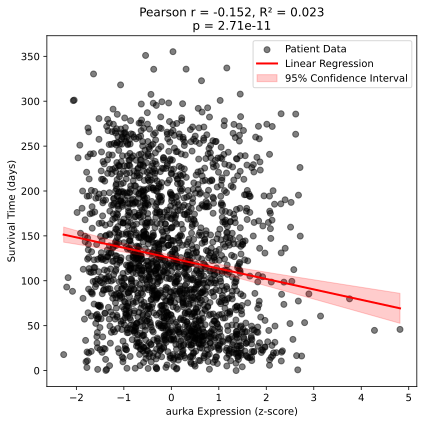
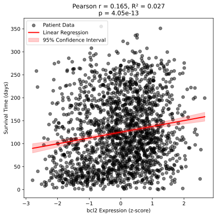
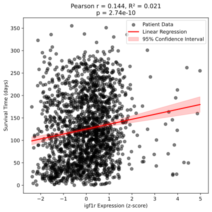
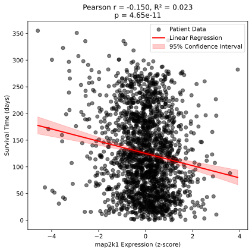
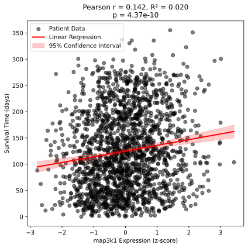
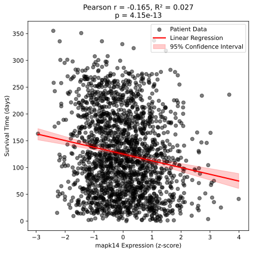
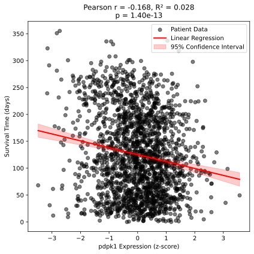
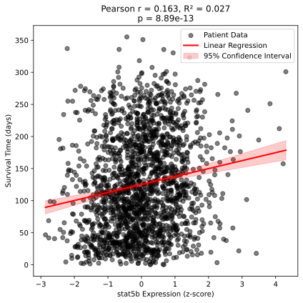
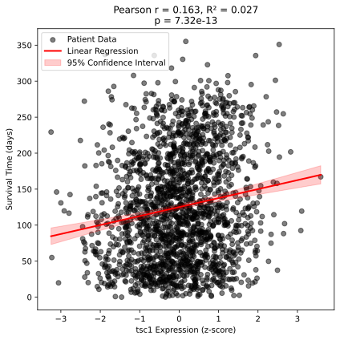

# kaggle_analysis
For CSCI 6118; this README contains the outline of the presentation. I still 
included a powerpoint here, as I thought we would be presenting in class 
Thursday. \
\
Introduction: \
\
In this assignment, I took the provided Kaggle dataset and explored the 
relationship between gene expression and patient survivability. Typically in 
molecular biology, these kinds of analyses compare gene expression with a 
quantitative metric for cell or system viability. Here, since we have patient 
outcome data, we can directly compare gene expression to patient outcomes. \
\
Results: \
\
After analyzing the relationship between gene expression and survivability, 
relevant genes were ranked based on correlation between these two paramters. 
Out of all of the genes, 10 were selected and plotted below. These 10 genes
are: adam17. aurka, bcl2, igf1r, map2k1, map3k1, mapk14, pdpk1, stat5b, and 
tsc1. Of these 10, half showed an increase in survivability when upregulated 
(igf1r, map3k1, tsc1, bcl2, and stat5b) and half showed a decrease in 
survivability when upregulated (map2k, adam17, aurka, mapk14, and pdpk1). 
Unsurprisingly, these trends are quite weak, with coefficients of determination
never surpassing 0.03. Interestingly, many of these are kinases, which suggests
much of the patient outcome is derived from changes in intracellular signaling 
pathways. \

\
Methods: \
The code to reproduce these results is set up to be run via two different 
paths: within a code-editing software (like Spyder) or through the command 
line. Figures are then output to the directory: 'Regression_Figures'.\
\
Within a code-editing software, the program must only be run. The restriction 
when using this method is that the location of the input document is fixed to 
the reference location (same parent directory). \
\
If using the command line, you would run the command: 'python analysis.py'. 
This method has the same restriction, as the code doesn't require any input 
paramters.